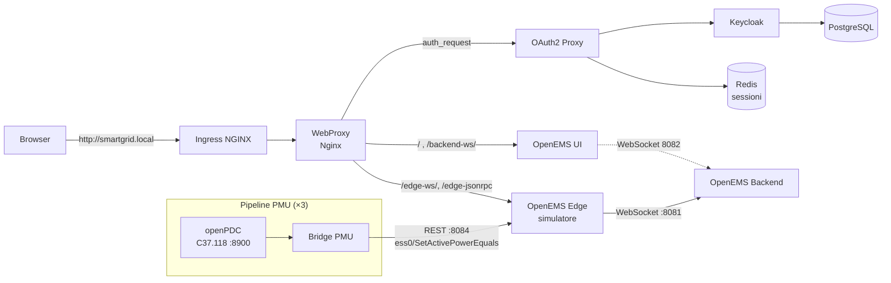

# Smart Grid su Kubernetes

Ambiente Smart Grid su **Minikube**, descritto interamente con **Kustomize**.
I fasori delle PMU passano da openPDC a un bridge, che li converte in setpoint di potenza per una batteria simulata in **OpenEMS**. Tutto è accessibile dal browser dietro un unico reverse proxy protetto da **Keycloak + OAuth2 Proxy**.

I comandi sono indicati per **Linux (bash)** e **Windows (PowerShell)**. Dove il comando è lo stesso nelle due shell compare una volta sola: `kubectl` accetta i percorsi con `/` anche su Windows.

---

## Indice

1. [Architettura](#1-architettura)
2. [Struttura del repository](#2-struttura-del-repository)
3. [Requisiti](#3-requisiti)
4. [Avvio rapido](#4-avvio-rapido)
5. [Accesso e rotte](#5-accesso-e-rotte)
6. [Autenticazione](#6-autenticazione)
7. [Sicurezza di rete (NetworkPolicy)](#7-sicurezza-di-rete-networkpolicy)
8. [Secret: gestione e rotazione](#8-secret-gestione-e-rotazione)
9. [Persistenza e backup](#9-persistenza-e-backup)
10. [Comportamento della simulazione](#10-comportamento-della-simulazione)
11. [Affidabilità: probe e ordine di avvio](#11-affidabilità-probe-e-ordine-di-avvio)
12. [Versioni delle immagini](#12-versioni-delle-immagini)
13. [Diagnostica e problemi noti](#13-diagnostica-e-problemi-noti)
14. [Operazioni quotidiane](#14-operazioni-quotidiane)
15. [Git: cosa versionare](#15-git-cosa-versionare)
16. [Verifiche eseguite](#16-verifiche-eseguite)
17. [Scelte progettuali e limiti noti](#17-scelte-progettuali-e-limiti-noti)
18. [Storico delle modifiche](#18-storico-delle-modifiche)

---

## 1. Architettura



| Componente | Deployment | Immagine | Ruolo |
|---|---|---|---|
| OpenEMS Edge | `openems` | `openems/edge` | Simulatore: carico H0, contatore di rete `meter0`, batteria `ess0`, controller di bilanciamento. REST (8084) e WebSocket (8085) |
| OpenEMS Backend | `openems-backend` | `openems/backend:2025.1.0` | Riceve i dati dall'Edge (8081) e serve la UI (8082) |
| OpenEMS UI | `openems-ui-backend` | `openems/ui-backend:2025.1.0` | Interfaccia web, servita su `/` |
| openPDC (×3) | `pdc-edge`, `pdc-edge-2`, `pdc-edge-3` | `gridprotectionalliance/openpdc:v2.9.148` | Concentratori di fasori, stream IEEE C37.118 sulla 8900 |
| Bridge PMU (×3) | `bridge-1`, `bridge-2`, `bridge-3` | `ghcr.io/tommso00/pmu-bridge` | Leggono i fasori e scrivono `ess0/SetActivePowerEquals` sulla REST dell'Edge |
| Keycloak | `keycloak` | `quay.io/keycloak/keycloak:26.2` | Identity provider, realm `openems` |
| PostgreSQL | `keycloak-db` | `postgres:16-alpine` | Database di Keycloak |
| OAuth2 Proxy | `oauth2-proxy` | `quay.io/oauth2-proxy/oauth2-proxy:v7.8.1` | Login OIDC per Nginx |
| Redis | `redis` | `redis:7-alpine` | Sessioni di OAuth2 Proxy |
| WebProxy | `webproxy` | `nginx:alpine` | Unico punto d'ingresso: routing e controllo del login |

Tutto gira nel namespace `smartgrid`.

---

## 2. Struttura del repository

```text
theses-Santus/
├── README.md
├── .gitignore
├── base/
│   ├── kustomization.yaml            # moduli + versioni immagini (digest)
│   ├── namespace.yaml                # namespace "smartgrid"
│   ├── auth/                         # Keycloak, PostgreSQL, OAuth2 Proxy, Redis, WebProxy, Ingress
│   │   ├── auth-secrets.env          # secret locali (NON versionato)
│   │   ├── auth-secrets.env.example  # modello da copiare
│   │   ├── keycloak-realm-configmap.yaml
│   │   └── webproxy-configmap.yaml   # nginx.conf
│   ├── openems/                      # Edge, configurazione simulatore, NetworkPolicy
│   └── apps/
│       ├── openems-backend/
│       ├── openems-ui-backend/
│       ├── pdc-edge/  pdc-edge-2/  pdc-edge-3/
│       └── bridge-1/  bridge-2/  bridge-3/
└── overlays/
    └── minikube/                     # specifico di Minikube: Ingress senza host, label
```

Il **base** descrive lo stack; l'**overlay** `minikube` aggiunge solo ciò che è specifico dell'ambiente.

---

## 3. Requisiti

| | Linux | Windows |
|---|---|---|
| Container runtime | Docker Engine, utente nel gruppo `docker` (`sudo usermod -aG docker $USER`, poi rifare il login) | Docker Desktop |
| Strumenti | `minikube`, `kubectl` (Kustomize è incluso) | `minikube`, `kubectl`, PowerShell |
| Risorse | Il driver Docker usa le risorse della macchina: servono almeno **4 CPU** | Da assegnare: `minikube start --cpus=4 --memory=8192` |

I pod richiedono in totale circa **2,1 CPU e 3,4 GiB**, con limiti fino a 6 CPU e 6,8 GiB.

Il CNI deve supportare le **NetworkPolicy**. kindnet, il default di Minikube, le applica: è stato verificato su questo cluster (vedi [§16](#16-verifiche-eseguite)).

---

## 4. Avvio rapido

### 4.1 Cluster e Ingress

```bash
minikube start                      # Windows: minikube start --cpus=4 --memory=8192
minikube addons enable ingress
```

### 4.2 Secret

```bash
cp base/auth/auth-secrets.env.example base/auth/auth-secrets.env                 # bash
```

```powershell
Copy-Item base\auth\auth-secrets.env.example base\auth\auth-secrets.env          # PowerShell
```

Compilare i valori. Nel file ci sono i comandi per generarli, in entrambe le shell. Dettagli in [§8](#8-secret-gestione-e-rotazione).

### 4.3 Deploy

```bash
kubectl apply -k overlays/minikube
kubectl get pods -n smartgrid -w
```

Attendere che tutti i pod siano `Running` e `1/1`. Keycloak e openPDC possono impiegare qualche minuto.
Per vedere i manifest senza applicarli: `kubectl kustomize overlays/minikube > rendered-minikube.yaml` (il file è ignorato da Git).

### 4.4 Hostname `smartgrid.local`

**Linux.** L'IP di Minikube è raggiungibile direttamente, quindi non serve il tunnel:

```bash
echo "$(minikube ip) smartgrid.local" | sudo tee -a /etc/hosts
curl -s http://smartgrid.local/monitor/         # → {"service":"webproxy","status":"ok"}
```

**Windows.** Serve `minikube tunnel`, in una finestra da lasciare aperta. Poi, come amministratore, aggiungere a `C:\Windows\System32\drivers\etc\hosts`:

```text
127.0.0.1 smartgrid.local
```

### 4.5 Primo accesso

Aprire `http://smartgrid.local/`: si viene rimandati al login Keycloak (utente `testuser`, password in `auth-secrets.env`) e poi alla UI di OpenEMS.

---

## 5. Accesso e rotte

Tutto passa dal WebProxy. Le rotte applicative richiedono il login.

| Percorso | Destinazione | Login |
|---|---|---|
| `/` | UI OpenEMS | ✅ |
| `/backend-ui/` | UI OpenEMS | ✅ |
| `/backend-ws/` | WebSocket UI del Backend (8082) | ✅ |
| `/openems-edge` | WebSocket UI del Backend (8082), duplicato di `/backend-ws/` | ✅ |
| `/edge-ws/` | WebSocket dell'Edge (8085) | ✅ |
| `/edge-jsonrpc` | JSON-RPC dell'Edge (8084) | ✅ (senza sessione risponde `401`) |
| `/oauth2/…` | OAuth2 Proxy | – |
| `/auth/…`, `/realms/`, `/resources/`, `/js/` | Keycloak (login e console `/auth/admin/`) | – |
| `/monitor/` | Health check del proxy | – |
| `/monitor/bridges/{1,2,3}/{health,status}` | Stato dei bridge | – |

**Accesso diretto a un servizio**, senza proxy, ad esempio per script o per la UI di openPDC:

```bash
kubectl port-forward -n smartgrid svc/openems 8084:8084       # REST dell'Edge
kubectl port-forward -n smartgrid svc/pdc-edge 8280:8280      # UI openPDC → http://localhost:8280
```

---

## 6. Autenticazione

```text
Browser → WebProxy (auth_request) → OAuth2 Proxy → Keycloak (realm openems)
        → /oauth2/callback → sessione salvata in Redis
```

- **Client Keycloak:** `openems-gateway`, confidenziale, con PKCE S256. Redirect URI `http://smartgrid.local/oauth2/callback`.
- **Hostname fisso:** con `KC_HOSTNAME=http://smartgrid.local/auth`, l'issuer dei token è sempre `http://smartgrid.local/auth/realms/openems`. Con `KC_HOSTNAME_BACKCHANNEL_DYNAMIC=true`, OAuth2 Proxy scambia i token con Keycloak sull'indirizzo interno del Service.
- **Redirect dopo il login:** solo verso `smartgrid.local` (`OAUTH2_PROXY_WHITELIST_DOMAINS`), per evitare open redirect.
- **Realm:** viene importato al primo avvio da `keycloak-realm-configmap.yaml`. Il JSON non contiene secret: client secret e password di `testuser` sono placeholder `${…}`, che Keycloak risolve dalle variabili d'ambiente.

---

## 7. Sicurezza di rete (NetworkPolicy)

`base/openems/networkpolicy.yaml` limita chi può raggiungere OpenEMS Edge:

| Da | Porta | Motivo |
|---|---|---|
| `bridge-1/2/3` | 8084 (REST) | Scrittura dei setpoint |
| `webproxy` | 8084, 8085 | `/edge-jsonrpc`, `/edge-ws/` (dietro login) |
| qualsiasi altro pod | – | **bloccato**, compresa la console Felix (8080) |

Le probe del kubelet e `kubectl port-forward` non sono interessate dalla policy. Il traffico in uscita dall'Edge verso il Backend non è limitato.

**Verifica:** il primo comando deve rispondere `BLOCCATO`, il secondo `RAGGIUNGIBILE`.

```bash
kubectl run np-check --rm -i --restart=Never -n smartgrid --image=busybox:1.36 -- sh -c 'nc -z -w 3 openems 8084 && echo RAGGIUNGIBILE || echo BLOCCATO'
kubectl exec -n smartgrid deploy/webproxy -- sh -c 'nc -z -w 3 openems 8084 && echo RAGGIUNGIBILE || echo BLOCCATO'
```

---

## 8. Secret: gestione e rotazione

Tutti i secret stanno in `base/auth/auth-secrets.env`, che è in `.gitignore`. Kustomize genera da questo file il Secret `auth-secrets` (`secretGenerator`).

Il file però **non è l'unica fonte della verità**: alcuni valori vengono letti solo alla prima inizializzazione, e dopo vanno cambiati nel servizio stesso.

| Chiave | Chi la usa | Basta cambiare il file? |
|---|---|---|
| `OAUTH2_PROXY_COOKIE_SECRET` | OAuth2 Proxy | ✅ sì |
| `OAUTH2_PROXY_CLIENT_SECRET` | OAuth2 Proxy (+ import del realm) | ⚠️ solo dopo averlo rigenerato in Keycloak |
| `KEYCLOAK_DB_PASSWORD` | PostgreSQL (solo alla creazione) + Keycloak | ❌ prima `ALTER USER` nel database |
| `KEYCLOAK_ADMIN_PASSWORD` | Keycloak (solo al primo avvio) | ❌ si cambia in Keycloak |
| `KEYCLOAK_TESTUSER_PASSWORD` | Import del realm (solo se il realm non esiste) | ❌ si cambia in Keycloak |
| `OPENEMS_EDGE_USER` / `OPENEMS_EDGE_PASSWORD` | Bridge → REST dell'Edge | ❌ prima si cambia l'utente nell'Edge (default `admin`/`admin`) |
| `OAUTH2_PROXY_CLIENT_ID` | OAuth2 Proxy | non è un secret |

### Applicare il Secret dopo una modifica

Comando identico in bash e PowerShell. I pod vedono i nuovi valori solo dopo un riavvio.

```bash
kubectl create secret generic auth-secrets -n smartgrid --from-env-file=base/auth/auth-secrets.env --dry-run=client -o yaml | kubectl apply -f -
kubectl rollout restart deployment/<nome> -n smartgrid
```

### Cookie secret (32 byte)

```bash
openssl rand -base64 32 | tr -- '+/' '-_'                                                                  # bash
```

```powershell
[Convert]::ToBase64String((1..32 | % {[byte](Get-Random -Max 256)})).Replace('+','-').Replace('/','_')    # PowerShell
```

Poi aggiornare il file, applicare il Secret e riavviare `oauth2-proxy`. Le sessioni aperte decadono.

### Client secret di `openems-gateway`

1. Console `http://smartgrid.local/auth/admin/` → realm `openems` → Clients → `openems-gateway` → Credentials → **Regenerate**.
2. Copiare il valore in `OAUTH2_PROXY_CLIENT_SECRET` e applicare il Secret.
3. `kubectl rollout restart deployment/oauth2-proxy -n smartgrid`

Tra il passo 1 e il passo 3 il login non funziona (`unauthorized_client`).

### Password del database di Keycloak

L'ordine è importante: **prima il database, poi il file**. Se si cambia solo il file, Keycloak non riesce più a connettersi.

```bash
kubectl exec -n smartgrid deploy/keycloak-db -- psql -U keycloak -d keycloak -c "ALTER USER keycloak PASSWORD 'NUOVA_PASSWORD';"
# aggiornare KEYCLOAK_DB_PASSWORD nel file e applicare il Secret, poi:
kubectl rollout restart deployment/keycloak -n smartgrid
```

### Password dell'admin Keycloak e di `testuser`

Si cambiano dalla console (Users → utente → Credentials) oppure con `kcadm.sh`:

```bash
kubectl exec -n smartgrid deploy/keycloak -- /opt/keycloak/bin/kcadm.sh config credentials --server http://localhost:8080/auth --realm master --user admin --password 'PASSWORD_ATTUALE'
kubectl exec -n smartgrid deploy/keycloak -- /opt/keycloak/bin/kcadm.sh set-password -r master --username admin --new-password 'NUOVA_PASSWORD'
kubectl exec -n smartgrid deploy/keycloak -- /opt/keycloak/bin/kcadm.sh set-password -r openems --username testuser --new-password 'NUOVA_PASSWORD'
```

Poi si aggiorna anche il file, così un'installazione da zero usa gli stessi valori.

> **Cronologia Git.** Le versioni precedenti del repository contengono vecchi secret (`base/auth/secrets.yaml`). Una volta ruotati, quei valori non servono più. La cronologia non è stata riscritta: farlo richiede `git filter-repo` e un push forzato concordato con chi usa il repository.

---

## 9. Persistenza e backup

| PVC | Dim. | Contenuto |
|---|---|---|
| `keycloak-db-data` | 5 Gi | Database di Keycloak (realm, utenti, client) |
| `openems-conf` / `openems-data` | 2 / 5 Gi | Configurazione e dati dell'Edge |
| `openems-backend-conf` / `openems-backend-data` | 1 / 5 Gi | Configurazione e dati del Backend |
| `pdc-edge-config`, `pdc-edge-2-config`, `pdc-edge-3-config` | 1 Gi | `openPDC.db`, la configurazione di openPDC |

Come si comporta ogni servizio:

- **Keycloak.** Se il database esiste già, l'import del realm viene saltato (`IGNORE_EXISTING`). Le modifiche dalla console restano, ma le modifiche al JSON del realm non vengono applicate.
- **OpenEMS Edge.** A ogni avvio gli initContainer riscrivono i controller (Backend, WebSocket, REST ReadWrite 8084) e la configurazione del simulatore, scheduler compreso: **i manifest sono la fonte della verità**. Se la UI ha creato un'altra configurazione con lo stesso `id` di un componente gestito (es. un secondo `scheduler0`), viene rimossa all'avvio e il log di `simulator-config-init` lo segnala. Se nel PVC esiste già un controller REST ReadWrite creato dalla UI, non ne viene creato un secondo.
- **openPDC.** Al primo avvio con PVC vuoto copia la configurazione di default dell'immagine. Da lì in poi le modifiche fatte dalla sua UI sopravvivono ai riavvii.
- **Redis** non è persistente: se si riavvia, bisogna rifare il login.

⚠️ **Non cancellare i PVC** (soprattutto `keycloak-db-data`) e non eseguire `minikube delete` se si vuole conservare lo storage.

### Backup di openPDC

```bash
# bash
mkdir -p backup/openpdc
for d in pdc-edge pdc-edge-2 pdc-edge-3; do
  pod=$(kubectl get pod -n smartgrid -l app=$d -o jsonpath='{.items[0].metadata.name}')
  kubectl cp "smartgrid/$pod:/opt/openPDC/ConfigurationCache/openPDC.db" "backup/openpdc/$d-openPDC.db"
done
```

```powershell
# PowerShell
New-Item -ItemType Directory -Force backup\openpdc | Out-Null
foreach ($d in "pdc-edge","pdc-edge-2","pdc-edge-3") {
  $pod = kubectl get pod -n smartgrid -l app=$d -o jsonpath='{.items[0].metadata.name}'
  kubectl cp "smartgrid/${pod}:/opt/openPDC/ConfigurationCache/openPDC.db" "backup/openpdc/$d-openPDC.db"
}
```

Ripristino: `kubectl cp` in senso inverso, poi `kubectl rollout restart deployment/<pdc> -n smartgrid`. La cartella `backup/` è ignorata da Git.

---

## 10. Comportamento della simulazione

**Flusso dei dati.** openPDC pubblica frame C37.118 (`idcode=235`) sulla porta 8900. Ogni bridge legge il fasore `PHASOR_1` e calcola una potenza equivalente (`p_eq = magnitudo × P_EQ_SCALE`, con `P_EQ_SCALE=0.001`). Ogni secondo la scrive su `ess0/SetActivePowerEquals` tramite la REST dell'Edge. L'Edge invia i dati al Backend, che li mostra nella UI.

| Aspetto | Comportamento |
|---|---|
| **Sorgente dati** | Lo stream dimostrativo della configurazione di default di openPDC (rete a 60 Hz). Scelta voluta per questo ambiente |
| **Solo dati reali** | `ALLOW_SYNTHETIC_FALLBACK=false`: se openPDC non invia dati, il bridge **smette di pubblicare** (`connected: false`, `mode: retrying`) invece di generare valori |
| **Priorità dei setpoint** | Nello scheduler, `ctrlApiRest0` gira **prima** di `ctrlBalancing0`: quando un bridge scrive, il bilanciamento non può sovrascrivere il setpoint in quel ciclo. È normale che il bilanciamento segnali il conflitto nei log |
| **Tre bridge, una batteria** | I tre bridge scrivono tutti su `ess0`. Nello stesso ciclo conta l'ultima scrittura, quindi la batteria segue di volta in volta l'ultimo bridge che ha scritto. Scelta accettata per questo ambiente |
| **Tenuta del setpoint** | Il controller REST ha `apiTimeout=60`: dopo l'ultima scrittura il setpoint resta attivo per **60 s**, poi torna il bilanciamento. Il bridge considera invece vecchi i dati dopo 10 s (`STALE_DATA_S`) |

**Stato di un bridge** (dati ricevuti, ultimo campione, ultima pubblicazione):

```bash
curl -s http://smartgrid.local/monitor/bridges/1/status
```

---

## 11. Affidabilità: probe e ordine di avvio

| Componente | Startup | Readiness | Liveness |
|---|---|---|---|
| Keycloak | HTTP `:9000/auth/health/started` | HTTP `:9000/auth/health/ready` | HTTP `:9000/auth/health/live` |
| PostgreSQL | – | TCP 5432 | TCP 5432 |
| OAuth2 Proxy | – | HTTP `/ping` | HTTP `/ping` |
| Redis | – | `redis-cli ping` | `redis-cli ping` |
| WebProxy | – | HTTP `/monitor/` | HTTP `/monitor/` |
| OpenEMS Edge | – | TCP 8085 | TCP 8085 |
| OpenEMS Backend | TCP **8081** | TCP 8082 | TCP **8081** |
| UI OpenEMS | – | HTTP `/` | TCP 80 |
| openPDC | TCP 8280 | TCP 8900 | TCP 8280 |
| Bridge | – | TCP 8000 | TCP 8000 |

Per i bridge la probe è TCP e non HTTP `/health`: così `/monitor/bridges/N/health` resta leggibile anche quando il bridge segnala un problema.

**Ordine di avvio**, garantito dagli initContainer:

- i bridge aspettano openPDC (8900) e la REST dell'Edge (8084);
- OAuth2 Proxy aspetta Redis;
- il WebProxy aspetta che il DNS risolva tutti i Service usati in `nginx.conf`. Senza questa attesa, dopo `minikube start` Nginx usciva con "host not found".

---

## 12. Versioni delle immagini

In `base/kustomization.yaml` ogni immagine è scritta come `tag@sha256:digest`. **Conta il digest**: anche se `latest` viene ripubblicato, il cluster usa sempre la stessa immagine. I digest sono quelli del cluster funzionante al 2026-09-10.

Per aggiornare un'immagine (identico in bash e PowerShell), poi copiare il digest in `base/kustomization.yaml`:

```bash
docker pull openems/edge:2025.1.0
docker inspect --format '{{index .RepoDigests 0}}' openems/edge:2025.1.0
```

---

## 13. Diagnostica e problemi noti

### Comandi di base

Identici in bash e PowerShell:

```bash
kubectl get pods -n smartgrid -o wide
kubectl get events -n smartgrid --sort-by=.lastTimestamp
kubectl describe pod -n smartgrid <POD>
kubectl logs -n smartgrid deploy/<DEPLOYMENT> --tail=200
kubectl logs -n smartgrid deploy/<DEPLOYMENT> --previous
kubectl exec -n smartgrid deploy/webproxy -- nginx -t
kubectl diff -k overlays/minikube
```

`--previous` mostra il log del container prima del crash; `nginx -t` controlla la sintassi di Nginx; `diff` confronta i manifest con il cluster.

### Problemi noti

| Sintomo | Causa | Soluzione |
|---|---|---|
| UI: **"Server nicht erreichbar"**. Nel log del webproxy, `GET /backend-ws/ … 302` | Sessione non valida (di solito Redis riavviato) e pagina servita dalla cache del browser | Finestra anonima, oppure cancellare i dati del sito `smartgrid.local` |
| UI: **"OpenEMS ist Offline"**. Nell'Edge `ctrlBackend0 NOT CONNECTED`, nel Backend `[Edge.Websocket] NOT STARTED` | Race all'avvio in OpenEMS Backend 2025.1.0: il server 8081 non parte | Automatica: lo `startupProbe` sulla 8081 riavvia il Backend entro ~2 min. A mano: `kubectl rollout restart deployment/openems-backend -n smartgrid` |
| Edge: `FAULT: Configuration has duplicated Component-IDs` | Una configurazione creata dalla UI con lo stesso `id` di una gestita dai manifest | Automatica al riavvio dell'Edge (vedi [§9](#9-persistenza-e-backup)). Controllo: `kubectl logs -n smartgrid deploy/openems -c simulator-config-init` |
| Bridge `0/1` con `Readiness probe failed` subito dopo l'avvio | Il bridge apre la porta 8000 dopo `STARTUP_DELAY_S=15` | Nessuna: si risolve da sola in pochi secondi |
| Tutti i pod con 1 restart ed exit code 255 | Riavvio del nodo (`minikube stop/start`, VM in pausa) | Nessuna. I pod rimasti `Unknown` si cancellano: `kubectl delete pod -n smartgrid <POD>` |

### Controlli rapidi

```bash
# Il Backend accetta gli Edge? (devono esserci 8081 e 8082)
kubectl logs -n smartgrid deploy/openems-backend | grep "Starting websocket server"

# Stato dell'Edge (deve essere State:Ok e ctrlBackend0[Connected])
kubectl logs -n smartgrid deploy/openems --tail=20 | grep ctrlDebugLog0

# Issuer OIDC (deve essere http://smartgrid.local/auth/realms/openems)
curl -s http://smartgrid.local/auth/realms/openems/.well-known/openid-configuration | grep -o '"issuer":"[^"]*"'
```

In PowerShell si usa `curl.exe` al posto di `curl`, e `Select-String` al posto di `grep`.

**Valore attuale della batteria**, tramite port-forward, che la NetworkPolicy non blocca:

```bash
kubectl port-forward -n smartgrid svc/openems 8084:8084
curl -s -u admin:admin http://localhost:8084/rest/channel/ess0/ActivePower        # in un secondo terminale
```

Usare le credenziali di `OPENEMS_EDGE_USER`/`OPENEMS_EDGE_PASSWORD`.

---

## 14. Operazioni quotidiane

```bash
minikube stop                                   # sospende tutto, i dati restano
minikube start                                  # Windows: poi di nuovo `minikube tunnel`
kubectl get pods -n smartgrid

kubectl apply -k overlays/minikube              # dopo una modifica ai manifest
kubectl rollout restart deployment/openems -n smartgrid   # dopo una modifica alla configurazione del simulatore
```

`kubectl apply` **non cancella** le risorse tolte dai manifest: vanno eliminate a mano con `kubectl delete`.

```bash
minikube delete        # ⚠️ distruttivo: cancella il cluster e tutti i PVC
```

---

## 15. Git: cosa versionare

Il `.gitignore` esclude:

| Categoria | Pattern |
|---|---|
| Secret | `base/auth/auth-secrets.env`, `*.secret.env`, `.env*` (tranne `*.env.example`), `*.pem`, `*.key`, `*.crt`, `*.pfx`, `*.p12`, kubeconfig |
| File generati | `cluster-state.yaml`, `rendered-*.yaml`, `*.log` |
| Backup | `backup/`, `*.db`, `*.sqlite`, `*.sql`, `*.dump`, `*.bak` |
| Editor/OS | `.vscode/`, `.idea/`, `*.swp`, `Thumbs.db`, `desktop.ini`, `.DS_Store` |

Alcuni file erano già tracciati prima del `.gitignore`. Vanno tolti da Git una volta sola; restano sul disco:

```bash
git rm --cached cluster-state.yaml overlays/minikube/backend.log
git rm -r --cached backup
```

Prima di ogni commit controllare che `auth-secrets.env` **non** compaia in `git status`. Su Windows il `.gitignore` è un file nascosto: attenzione a non perderlo copiando la cartella.

---

## 16. Verifiche eseguite

Verifiche fatte sul cluster Minikube (Fedora, driver Docker, kindnet) il 2026-09-25:

| Verifica | Esito |
|---|---|
| Tutti i pod `Running` e `1/1` | ✅ |
| Login completo Keycloak → UI OpenEMS | ✅ |
| Issuer OIDC = `http://smartgrid.local/auth/realms/openems` | ✅ |
| NetworkPolicy: pod qualsiasi → Edge 8084 | ✅ `BLOCCATO` |
| NetworkPolicy: webproxy → Edge 8084 | ✅ `RAGGIUNGIBILE` |
| kindnet applica le NetworkPolicy (test `deny-all` in un namespace di prova) | ✅ |
| Edge `State:Ok`, `ctrlBackend0[Connected]` | ✅ |
| Bridge → Edge: `OK pdc=1 component=ess0 channel=SetActivePowerEquals` | ✅ |
| openPDC spento: il bridge smette di pubblicare, niente dati sintetici | ✅ |
| Rimozione automatica dello `scheduler0` duplicato | ✅ |
| Backend riavviato automaticamente dallo `startupProbe` (race sulla 8081) | ✅ |

---

## 17. Scelte progettuali e limiti noti

**Scelte progettuali**

- **I manifest sono la fonte della verità.** Configurazione dell'Edge e scheduler vengono riscritti a ogni avvio. Le modifiche fatte dalla UI di OpenEMS a quei componenti non sono persistenti per scelta.
- **Sorgente PMU dimostrativa** e **tre bridge sulla stessa batteria**: accettati per questo ambiente (vedi [§10](#10-comportamento-della-simulazione)).
- **Nessun dato sintetico**: meglio un buco nei dati che un valore inventato.
- **Immagini fissate per digest** per la riproducibilità degli esperimenti.

**Limiti noti** (accettabili su Minikube, non in produzione)

- Keycloak gira in `start-dev`; tutto il traffico è in HTTP (`COOKIE_SECURE=false`).
- Redis non ha password né persistenza.
- I container non hanno un `securityContext`; l'Edge usa ancora le credenziali di default `admin`/`admin`.
- La NetworkPolicy copre solo l'Edge.
- Mancano resource requests/limits su oauth2-proxy, redis, webproxy e UI.
- `/openems-edge` nel WebProxy duplica `/backend-ws/`.
- I secret della cronologia Git vanno ruotati (vedi [§8](#8-secret-gestione-e-rotazione)).

---

## 18. Storico delle modifiche

Revisione della configurazione originale, settembre 2026.

| Area | Prima | Dopo |
|---|---|---|
| Secret | `secrets.yaml` versionato, secret nel JSON del realm | `secretGenerator` + `auth-secrets.env` ignorato; placeholder `${…}` nel realm; credenziali dell'Edge nel Secret |
| Accesso web | Solo `/backend-ui/` protetta; redirect verso qualsiasi dominio | Tutte le rotte applicative dietro login; redirect solo verso `smartgrid.local`; redirect al login che conserva l'URL richiesto |
| REST dell'Edge | `factoryPid="Controller.Api.Rest"`, un componente che non esiste: la 8084 non si apriva | `Controller.Api.Rest.ReadWrite` su 8084 |
| Bridge | Scrivevano su `symmetricEss0`, che non esiste; fallback sintetico attivo; attesa sulla 8085 | Scrivono su `ess0`; fallback disattivato; attesa sulla 8084; credenziali dal Secret |
| Scheduler | Il bilanciamento prima della REST; `scheduler0` duplicato dalla UI | REST prima; duplicati rimossi automaticamente |
| Keycloak | Probe TCP; issuer dipendente dall'hostname della richiesta | Probe HTTP sulla porta di management 9000; `KC_HOSTNAME` fisso |
| Backend | Probe sulla console Felix (8079) | Probe sulla 8081/8082: riavvio automatico se la race blocca il server per gli Edge |
| Riavvii | oauth2-proxy e webproxy andavano in crash dopo `minikube start` | initContainer che aspettano Redis e il DNS |
| openPDC | Nessuna persistenza | PVC per istanza, seed della configurazione al primo avvio, probe |
| Immagini | `latest` e tag mobili | 12 immagini fissate per digest |
| Rete | Nessuna restrizione | NetworkPolicy sull'Edge |
| Pulizia | Patch ridondanti nell'overlay, ConfigMap mai montati, `openems-ui` senza rotta | Rimossi |