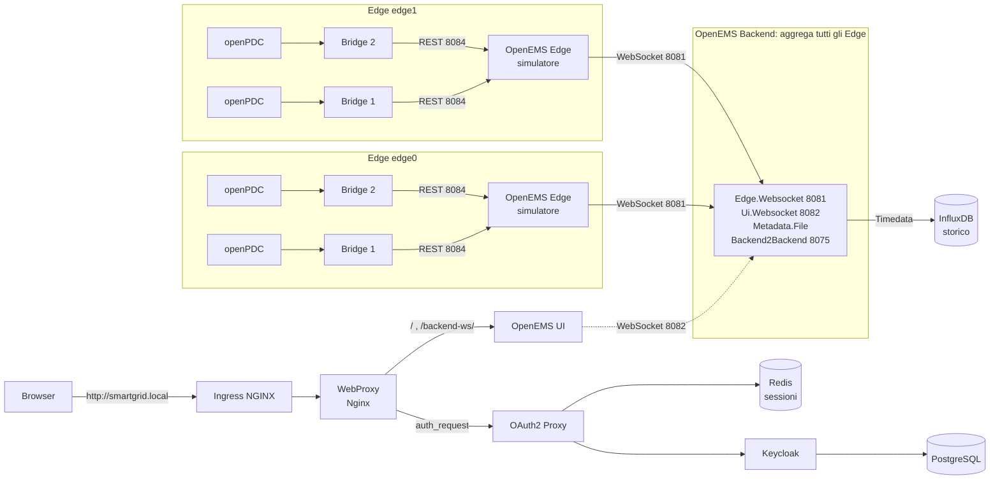

# Smart Grid su Kubernetes

Ambiente Smart Grid su **Minikube**, installato con un **chart Helm**.

Un numero a scelta di **Edge OpenEMS** (batterie simulate) è collegato a un unico **OpenEMS Backend**, che li aggrega: la UI li mostra tutti, lo storico di ognuno finisce in **InfluxDB** e un'API (**Backend2Backend**) permette di leggerli e comandarli da un solo punto. Ogni Edge ha un numero a scelta di **pipeline PMU**: i fasori passano da openPDC a un bridge, che li converte in setpoint di potenza per la batteria del proprio Edge. Tutto è accessibile dal browser dietro un unico reverse proxy protetto da **Keycloak + OAuth2 Proxy**.

Edge e pipeline si scelgono in un solo punto, la lista `edges` di [`values.yaml`](charts/smartgrid/values.yaml). La configurazione di esempio ha **2 Edge con 2 pipeline PMU ciascuno**.

I comandi sono indicati per **Linux (bash)** e **Windows (PowerShell)**. Dove il comando è lo stesso nelle due shell compare una volta sola.

---

## Indice

1. [Architettura](#1-architettura)
2. [Struttura del repository](#2-struttura-del-repository)
3. [Requisiti](#3-requisiti)
4. [Avvio rapido](#4-avvio-rapido)
5. [Topologia: scegliere Edge e pipeline PMU](#5-topologia-scegliere-edge-e-pipeline-pmu)
6. [OpenEMS Backend: gestione di tutti gli Edge](#6-openems-backend-gestione-di-tutti-gli-edge)
7. [Accesso e rotte](#7-accesso-e-rotte)
8. [Autenticazione](#8-autenticazione)
9. [Sicurezza di rete (NetworkPolicy)](#9-sicurezza-di-rete-networkpolicy)
10. [Secret: gestione e rotazione](#10-secret-gestione-e-rotazione)
11. [Persistenza e backup](#11-persistenza-e-backup)
12. [Comportamento della simulazione](#12-comportamento-della-simulazione)
13. [Affidabilità: probe e ordine di avvio](#13-affidabilità-probe-e-ordine-di-avvio)
14. [Versioni delle immagini](#14-versioni-delle-immagini)
15. [Diagnostica e problemi noti](#15-diagnostica-e-problemi-noti)
16. [Operazioni quotidiane](#16-operazioni-quotidiane)
17. [Migrazione dalla versione Kustomize](#17-migrazione-dalla-versione-kustomize)
18. [Git: cosa versionare](#18-git-cosa-versionare)
19. [Verifiche eseguite](#19-verifiche-eseguite)
20. [Scelte progettuali e limiti noti](#20-scelte-progettuali-e-limiti-noti)
21. [Storico delle modifiche](#21-storico-delle-modifiche)

---

## 1. Architettura



| Componente | Deployment | Immagine | Ruolo |
|---|---|---|---|
| OpenEMS Edge (×N) | `openems-<id>` (es. `openems-edge0`) | `openems/edge` | Simulatore: carico H0, contatore `meter0`, batteria `ess0`, controller di bilanciamento. REST (8084) e WebSocket (8085) |
| openPDC (×pipeline) | `pdc-<id>-<n>` (es. `pdc-edge1-2`) | `gridprotectionalliance/openpdc:v2.9.148` | Concentratore di fasori, stream IEEE C37.118 sulla 8900 |
| Bridge PMU (×pipeline) | `bridge-<id>-<n>` | `ghcr.io/tommso00/pmu-bridge` | Legge i fasori del proprio openPDC e scrive `ess0/SetActivePowerEquals` sulla REST del proprio Edge |
| OpenEMS Backend | `openems-backend` | `openems/backend:2025.1.0` | **Aggrega tutti gli Edge**: connessioni (8081), UI (8082), elenco degli Edge, storico, API Backend2Backend (8075). Vedi [§6](#6-openems-backend-gestione-di-tutti-gli-edge) |
| InfluxDB | `influxdb` | `influxdb:2.7-alpine` | Storico dei dati di tutti gli Edge, usato dal Backend |
| OpenEMS UI | `openems-ui` | `openems/ui-backend:2025.1.0` | Interfaccia web su `/`: panoramica degli Edge e dettaglio di ognuno |
| Keycloak | `keycloak` | `quay.io/keycloak/keycloak:26.2` | Identity provider, realm `openems` |
| PostgreSQL | `keycloak-db` | `postgres:16-alpine` | Database di Keycloak |
| OAuth2 Proxy | `oauth2-proxy` | `quay.io/oauth2-proxy/oauth2-proxy:v7.8.1` | Login OIDC per Nginx |
| Redis | `redis` | `redis:7-alpine` | Sessioni di OAuth2 Proxy |
| WebProxy | `webproxy` | `nginx:alpine` | Unico punto d'ingresso: routing e controllo del login |

Tutto gira nel namespace `smartgrid`. Con la topologia di esempio: 2 Edge, 4 openPDC, 4 bridge.

**Etichette.** Oltre ad `app` e alle etichette standard `app.kubernetes.io/*`, i pod di Edge, openPDC e bridge hanno `smartgrid.io/role` (`openems-edge`, `openpdc`, `pmu-bridge`) e `smartgrid.io/edge` (l'Edge a cui appartengono). Le usano le NetworkPolicy e servono per selezionare gruppi di pod:

```bash
kubectl get pods -n smartgrid -L smartgrid.io/edge,smartgrid.io/role   # ogni pod con Edge e ruolo
kubectl get pods -n smartgrid -l smartgrid.io/edge=edge1               # tutto ciò che appartiene a edge1
```

---

## 2. Struttura del repository

```text
theses-Santus/
├── README.md
├── .gitignore
├── .gitattributes                       # fine riga LF per il chart
├── secrets/
│   ├── auth-secrets.env.example         # modello delle credenziali
│   └── auth-secrets.env                 # credenziali locali (NON versionato)
└── charts/smartgrid/                    # chart Helm
    ├── Chart.yaml
    ├── values.yaml                      # QUI: Edge, pipeline PMU, risorse, immagini (digest)
    ├── values.schema.json               # controlli sui valori, eseguiti da Helm prima di installare
    ├── files/
    │   ├── nginx.conf                   # configurazione del WebProxy (rotte di Edge e bridge generate)
    │   ├── keycloak-realm.json          # realm importato al primo avvio
    │   ├── edge-config-init.sh          # scrive la configurazione OpenEMS nel PVC di ogni Edge
    │   └── backend-config-init.sh       # idem per il Backend (Edge registrati, storico, API)
    └── templates/
        ├── _helpers.tpl                 # etichette, topologia normalizzata, configurazione OSGi
        ├── NOTES.txt                    # riepilogo stampato dopo l'installazione
        ├── networkpolicy-default-deny.yaml
        ├── auth/                        # keycloak, keycloak-db, oauth2-proxy, redis, webproxy (+ Ingress)
        ├── openems/                     # backend, influxdb, ui, edges (uno per elemento di "edges")
        └── pmu/pipelines.yaml           # openPDC + bridge, uno per pipeline
```

Ogni file di `templates/` contiene tutto ciò che serve a un servizio: Deployment, Service, PVC, ConfigMap e la sua **NetworkPolicy**. Gli Edge e le pipeline non sono più cartelle copiate: un solo template li produce in base alla lista `edges`.

---

## 3. Requisiti

| | Linux | Windows |
|---|---|---|
| Container runtime | Docker Engine, utente nel gruppo `docker` (`sudo usermod -aG docker $USER`, poi rifare il login) | Docker Desktop |
| Strumenti | `minikube`, `kubectl`, `helm` 3 | `minikube`, `kubectl`, `helm` 3 (`winget install Helm.Helm`), PowerShell |
| Risorse di Minikube | `minikube start --cpus=4 --memory=8192` | Idem |

Con la topologia di esempio i pod richiedono in totale circa **1,9 CPU e 4,6 GiB** (limiti fino a 9,3 CPU e 10,3 GiB). Ogni Edge in più richiede 0,1 CPU e 256 Mi, ogni pipeline in più 0,3 CPU e 640 Mi (openPDC 250m/512Mi, bridge 50m/128Mi).

Il CNI deve supportare le **NetworkPolicy**. kindnet, il default di Minikube, le applica (verificato, vedi [§19](#19-verifiche-eseguite)).

---

## 4. Avvio rapido

### 4.1 Cluster e Ingress

```bash
minikube start --cpus=4 --memory=8192
minikube addons enable ingress
kubectl create namespace smartgrid
```

### 4.2 Credenziali

```bash
cp secrets/auth-secrets.env.example secrets/auth-secrets.env                 # bash
```

```powershell
Copy-Item secrets\auth-secrets.env.example secrets\auth-secrets.env          # PowerShell
```

Compilare i valori (nel file ci sono i comandi per generarli, in entrambe le shell), poi creare il Secret:

```bash
kubectl create secret generic auth-secrets -n smartgrid --from-env-file=secrets/auth-secrets.env --dry-run=client -o yaml | kubectl apply -f -
```

Il Secret non è gestito dal chart, così le password non finiscono nella cronologia delle release di Helm. Dettagli in [§10](#10-secret-gestione-e-rotazione).

### 4.3 Installazione

```bash
helm upgrade --install smartgrid charts/smartgrid -n smartgrid
kubectl get pods -n smartgrid -w
```

Lo stesso comando installa la prima volta e aggiorna le volte successive. Alla fine Helm stampa un riepilogo con gli Edge e le pipeline installati. Attendere che tutti i pod siano `Running` e `1/1`: Keycloak e openPDC possono impiegare qualche minuto.

Per vedere i manifest senza applicarli: `helm template smartgrid charts/smartgrid -n smartgrid > rendered.yaml` (il file è ignorato da Git).

### 4.4 Hostname `smartgrid.local`

**Linux.** L'IP di Minikube è raggiungibile direttamente, quindi non serve il tunnel:

```bash
echo "$(minikube ip) smartgrid.local" | sudo tee -a /etc/hosts
curl -s http://smartgrid.local/monitor/         # → {"service":"webproxy","status":"ok"}
```

**Windows.** Serve `minikube tunnel`, in una finestra da lasciare aperta. Poi, come amministratore, aggiungere a `C:\Windows\System32\drivers\etc\hosts`:

```text
127.0.0.1 smartgrid.local
```

### 4.5 Primo accesso

Aprire `http://smartgrid.local/`: si viene rimandati al login Keycloak (utente `testuser`, password in `auth-secrets.env`) e poi alla UI di OpenEMS, che mostra la panoramica di tutti gli Edge.

---

## 5. Topologia: scegliere Edge e pipeline PMU

Edge e pipeline si dichiarano nella lista `edges` di `charts/smartgrid/values.yaml`:

```yaml
edges:
  - id: edge0                  # ID OpenEMS (formato edgeN); è anche l'apikey verso il Backend
    comment: Edge 0 - simulatore
    pmu: 2                     # due pipeline con i valori di pmuDefaults
  - id: edge1
    simulator:                 # override del simulatore solo per questo Edge
      initialSoc: 70
      capacity: 20000
      maxApparentPower: 15000
    pmu:                       # oppure una lista, con override per pipeline
      - {}
      - bridge:
          env:
            PUBLISH_PHASOR_INDEX: "2"
```

I valori comuni stanno in `edgeDefaults` (simulatore, PVC, risorse, tenuta dei setpoint) e `pmuDefaults` (variabili d'ambiente e risorse dei bridge, PVC e risorse di openPDC). Il file è commentato voce per voce.

**Applicare una modifica:**

```bash
helm upgrade --install smartgrid charts/smartgrid -n smartgrid
```

Si può anche lasciare `values.yaml` com'è e tenere la propria topologia in un file a parte: `helm upgrade --install smartgrid charts/smartgrid -n smartgrid -f mia-topologia.yaml`.

Cosa succede automaticamente:

- per ogni Edge: Deployment, Service, due PVC, la sua configurazione OpenEMS (con la sua apikey) e la sua NetworkPolicy;
- per ogni pipeline: openPDC con PVC, bridge collegato al proprio openPDC e al proprio Edge, NetworkPolicy che li accoppiano;
- il Backend riceve il nuovo `metadata.json` e **riparte da solo** (annotazione `checksum/config`); lo stesso vale per il WebProxy, che riceve le nuove rotte, e per ogni Edge la cui configurazione è cambiata;
- **togliere** un Edge o una pipeline da `values.yaml` li rimuove dal cluster al successivo `helm upgrade`. I loro PVC restano (`helm.sh/resource-policy: keep`): si cancellano a mano se non servono, es. `kubectl delete pvc -n smartgrid pdc-edge1-2-config`.

**Controlli.** Prima di installare, Helm verifica i valori con `values.schema.json`: ID nel formato `edgeN`, numero di pipeline non negativo, SoC tra 0 e 100, nomi delle variabili d'ambiente, chiavi sconosciute (un errore di battitura come `simulatr:` viene segnalato invece di essere ignorato). Il chart controlla in più che ID e apikey non siano ripetuti. Le variabili che collegano bridge, openPDC ed Edge (`PDC_HOST`, `OPENEMS_BASE`, …) sono calcolate dal chart e non si possono sovrascrivere.

**Nomi generati** (Edge `edge1`, pipeline 2):

| Risorsa | Nome |
|---|---|
| Edge: Deployment, Service | `openems-edge1` |
| Edge: PVC | `openems-edge1-conf`, `openems-edge1-data` |
| Edge: ConfigMap di configurazione | `openems-edge1-config` |
| openPDC: Deployment, Service / PVC | `pdc-edge1-2` / `pdc-edge1-2-config` |
| Bridge: Deployment, Service | `bridge-edge1-2` |

Il bridge riceve un `PDC_ID` progressivo su tutta la flotta (1, 2, 3, …), nell'ordine di `edges`.

---

## 6. OpenEMS Backend: gestione di tutti gli Edge

Il componente che aggrega gli Edge è l'**OpenEMS Backend** stesso: è progettato per gestire molti Edge, e il chart ne configura i moduli in base alla topologia.

| Modulo del Backend | Cosa fa per tutti gli Edge |
|---|---|
| `Metadata.File` | Elenco degli Edge con le loro apikey (`metadata.json`, generato da `edges`). Un Edge si collega solo se la sua apikey è nell'elenco |
| `Edge.Websocket` (8081) | Riceve la connessione e i dati in tempo reale di ogni Edge (`ctrlBackend0`) |
| `Ui.Websocket` (8082) | Serve la UI: con più di un Edge la UI apre una **panoramica** con lo stato di tutti, e da lì il dettaglio di ognuno |
| `Timedata.InfluxDB` | Salva lo **storico** di tutti gli Edge su InfluxDB. La UI lo usa per grafici e storici; con `timedata.enabled: false` si torna a `Timedata.Dummy` (solo tempo reale) |
| `Backend2Backend.Rest` (8075) | **API JSON-RPC** per leggere e comandare tutti gli Edge da un solo punto (vedi sotto) |

### API Backend2Backend

Per sicurezza nessun pod può raggiungerla (vedi [§9](#9-sicurezza-di-rete-networkpolicy)): si usa dal proprio PC con un port-forward.

```bash
kubectl port-forward -n smartgrid svc/openems-backend 8075:8075
```

In un secondo terminale (bash):

```bash
B2B="curl -s -u admin:admin -H Content-Type:application/json http://localhost:8075/jsonrpc -d"

# Quali Edge sono online
$B2B '{"method":"getEdgesStatus","params":{"edgeIds":["edge0","edge1"]}}'

# Valori attuali di più Edge in una sola chiamata
$B2B '{"method":"getEdgesChannelsValues","params":{"ids":["edge0","edge1"],"channels":["_sum/EssSoc","_sum/EssActivePower","_sum/GridActivePower","_sum/ConsumptionActivePower"]}}'

# Comando a un Edge: 2000 W di scarica sulla batteria di edge1
$B2B '{"method":"edgeRpc","params":{"edgeId":"edge1","payload":{"method":"setChannelValue","params":{"componentId":"ess0","channelId":"SetActivePowerEquals","value":2000}}}}'
```

PowerShell:

```powershell
$h = @{ Authorization = 'Basic ' + [Convert]::ToBase64String([Text.Encoding]::ASCII.GetBytes('admin:admin')) }
function B2B($body) { Invoke-RestMethod -Method Post -Uri http://localhost:8075/jsonrpc -Headers $h -ContentType 'application/json' -Body ($body | ConvertTo-Json -Depth 6) }

B2B @{ method = 'getEdgesChannelsValues'; params = @{ ids = @('edge0','edge1'); channels = @('_sum/EssSoc','_sum/EssActivePower') } }
B2B @{ method = 'edgeRpc'; params = @{ edgeId = 'edge1'; payload = @{ method = 'setChannelValue'; params = @{ componentId = 'ess0'; channelId = 'SetActivePowerEquals'; value = 2000 } } } }
```

**Come funziona un comando.** Il Backend inoltra `setChannelValue` all'Edge sulla stessa connessione WebSocket che l'Edge usa per i dati; sull'Edge lo esegue `ctrlBackend0`. Il setpoint resta attivo per `edgeDefaults.apiTimeout` secondi (60) dall'ultima scrittura: per tenerlo più a lungo si ripete la chiamata. Nello scheduler di ogni Edge `ctrlBackend0` viene **prima** dei bridge: un comando dal Backend ha la precedenza sui setpoint delle PMU finché è attivo ([§12](#12-comportamento-della-simulazione)).

**Credenziali.** `Metadata.File` accetta qualsiasi utente e password e dà il ruolo di amministratore su tutti gli Edge: per questo l'API è chiusa a tutti i pod. Ogni chiamata, inoltre, rigenera la sessione di `Metadata.File`: dopo averla usata la UI può chiedere di nuovo il login OpenEMS (qualsiasi password va bene).

---

## 7. Accesso e rotte

Tutto passa dal WebProxy. Le rotte applicative richiedono il login.

| Percorso | Destinazione | Login |
|---|---|---|
| `/` | UI OpenEMS (tutti gli Edge) | ✅ |
| `/backend-ui/` | UI OpenEMS | ✅ |
| `/backend-ws/` | WebSocket UI del Backend (8082) | ✅ |
| `/edges/<id>/ws/` | WebSocket dell'Edge `<id>` (8085) | ✅ |
| `/edges/<id>/jsonrpc` | JSON-RPC dell'Edge `<id>` (8084) | ✅ (senza sessione risponde `401`) |
| `/oauth2/…` | OAuth2 Proxy | – |
| `/auth/…`, `/realms/`, `/resources/`, `/js/` | Keycloak (login e console `/auth/admin/`) | – |
| `/monitor/` | Health check del proxy | – |
| `/monitor/edges/<id>/bridges/<n>/{health,status}` | Stato del bridge `n` dell'Edge `<id>` | – |

Le rotte `/edges/…` e `/monitor/edges/…` sono generate dalla topologia (`files/nginx.conf`).

**Accesso diretto a un servizio**, senza proxy, ad esempio per script o per la UI di openPDC:

```bash
kubectl port-forward -n smartgrid svc/openems-edge0 8084:8084          # REST di edge0
kubectl port-forward -n smartgrid svc/pdc-edge0-1 8280:8280            # UI openPDC → http://localhost:8280
kubectl port-forward -n smartgrid deploy/openems-backend 8079:8079     # console Felix del Backend
```

---

## 8. Autenticazione

```text
Browser → WebProxy (auth_request) → OAuth2 Proxy → Keycloak (realm openems)
        → /oauth2/callback → sessione salvata in Redis
```

- **Client Keycloak:** `openems-gateway` (`auth.clientId`), confidenziale, con PKCE S256. Redirect URI `http://<global.host>/oauth2/callback`.
- **Hostname fisso:** con `KC_HOSTNAME=http://smartgrid.local/auth`, l'issuer dei token è sempre `http://smartgrid.local/auth/realms/openems`. Con `KC_HOSTNAME_BACKCHANNEL_DYNAMIC=true`, OAuth2 Proxy scambia i token con Keycloak sull'indirizzo interno del Service.
- **Un solo hostname:** issuer, redirect, cookie, whitelist e WebSocket della UI derivano tutti da `global.host`. Per usare un altro nome basta cambiare quel valore.
- **Redirect dopo il login:** solo verso `global.host` (`OAUTH2_PROXY_WHITELIST_DOMAINS`), per evitare open redirect.
- **Realm:** viene importato al primo avvio da `files/keycloak-realm.json`. Il JSON non contiene secret: client secret e password di `testuser` sono placeholder `${…}`, che Keycloak risolve dalle variabili d'ambiente.

---

## 9. Sicurezza di rete (NetworkPolicy)

Il namespace è in **default deny in ingresso** (`templates/networkpolicy-default-deny.yaml`): nessun pod riceve traffico da altri pod, salvo quanto permesso esplicitamente. Ogni servizio ha la sua policy nello stesso file del suo Deployment; per Edge, openPDC e bridge il chart ne crea una per istanza.

| Servizio | Da | Porta | Motivo |
|---|---|---|---|
| `webproxy` | Ingress NGINX (namespace `ingress-nginx`) | 80 | Unico punto d'ingresso dal browser |
| `oauth2-proxy` | `webproxy` | 4180 | `auth_request` e `/oauth2/` |
| `keycloak` | `webproxy`, `oauth2-proxy` | 8080 | Login dal browser; token e JWKS sull'indirizzo interno |
| `keycloak-db` | `keycloak` | 5432 | Database di Keycloak |
| `redis` | `oauth2-proxy` | 6379 | Sessioni (Redis non ha password: questa è la sua protezione) |
| `openems-ui` | `webproxy` | 80 | `/`, `/backend-ui/` |
| `openems-backend` | tutti gli Edge (`smartgrid.io/role=openems-edge`) | 8081 | WebSocket degli Edge |
| `openems-backend` | `webproxy`, `openems-ui` | 8082 | WebSocket della UI |
| `influxdb` | `openems-backend` | 8086 | Storico |
| `openems-<id>` (Edge) | i bridge **dello stesso Edge** | 8084 | Setpoint delle PMU |
| `openems-<id>` (Edge) | `webproxy` | 8084, 8085 | `/edges/<id>/jsonrpc`, `/edges/<id>/ws/` |
| `pdc-<id>-<n>` | solo il proprio bridge `bridge-<id>-<n>` | 8900 | Stream C37.118 |
| `bridge-<id>-<n>` | `webproxy` | 8000 | `/monitor/edges/…` |

Tutto il resto è **bloccato**: un bridge non può scrivere su un altro Edge né leggere l'openPDC di un'altra pipeline; nessun pod raggiunge l'API Backend2Backend (8075), la console Felix di Backend (8079) ed Edge (8080), il management di Keycloak (9000), la UI di openPDC (8280).

- **Non interessati:** le probe del kubelet, `kubectl port-forward` ed `exec`.
- **Traffico in uscita:** non è limitato (DNS, Edge → Backend, bridge → openPDC/Edge). Le regole in ingresso bastano a isolare i servizi senza rischiare di rompere il DNS.
- **Ingress Controller:** la policy del WebProxy ammette solo il namespace `ingress.controllerNamespace` (default `ingress-nginx`, quello dell'addon di Minikube).

**Verifica** (comandi identici in bash e PowerShell):

```bash
# Pod di prova: tutte le righe devono dire BLOCCATO
kubectl run np-check --rm -i --restart=Never -n smartgrid --image=busybox:1.36 -- sh -c 'for t in openems-edge0:8084 openems-backend:8081 openems-backend:8075 influxdb:8086 keycloak:8080 keycloak-db:5432 redis:6379 oauth2-proxy:4180 pdc-edge0-1:8900 bridge-edge0-1:8000 webproxy:80; do nc -z -w 3 ${t%:*} ${t#*:} && echo "$t RAGGIUNGIBILE" || echo "$t BLOCCATO"; done'

# WebProxy: Edge e bridge RAGGIUNGIBILE, redis, InfluxDB e API 8075 BLOCCATO
kubectl exec -n smartgrid deploy/webproxy -- sh -c 'for t in openems-edge0:8084 openems-edge1:8085 bridge-edge1-2:8000 redis:6379 influxdb:8086 openems-backend:8075; do nc -z -w 3 ${t%:*} ${t#*:} && echo "$t RAGGIUNGIBILE" || echo "$t BLOCCATO"; done'
```

Poi il test funzionale: login completo e `curl -s http://smartgrid.local/monitor/edges/edge0/bridges/1/status` con `connected: true`.

**Disattivarle temporaneamente** (per escludere la rete durante una diagnosi): `kubectl delete networkpolicy --all -n smartgrid`. Si ripristinano con `helm upgrade --install smartgrid charts/smartgrid -n smartgrid`.

---

## 10. Secret: gestione e rotazione

Tutte le credenziali stanno in `secrets/auth-secrets.env`, che è in `.gitignore`. Da questo file si crea il Secret `auth-secrets` (nome in `global.existingSecret`), che il chart usa ma non gestisce.

Il file però **non è l'unica fonte della verità**: alcuni valori vengono letti solo alla prima inizializzazione, e dopo vanno cambiati nel servizio stesso.

| Chiave | Chi la usa | Basta cambiare il file? |
|---|---|---|
| `OAUTH2_PROXY_COOKIE_SECRET` | OAuth2 Proxy | ✅ sì |
| `OAUTH2_PROXY_CLIENT_SECRET` | OAuth2 Proxy (+ import del realm) | ⚠️ solo dopo averlo rigenerato in Keycloak |
| `KEYCLOAK_DB_PASSWORD` | PostgreSQL (solo alla creazione) + Keycloak | ❌ prima `ALTER USER` nel database |
| `KEYCLOAK_ADMIN_PASSWORD` | Keycloak (solo al primo avvio) | ❌ si cambia in Keycloak |
| `KEYCLOAK_TESTUSER_PASSWORD` | Import del realm (solo se il realm non esiste) | ❌ si cambia in Keycloak |
| `OPENEMS_EDGE_USER` / `OPENEMS_EDGE_PASSWORD` | Bridge → REST degli Edge | ❌ prima si cambia l'utente negli Edge (default `admin`/`admin`) |
| `INFLUXDB_ADMIN_PASSWORD` | InfluxDB (solo al primo avvio) | ❌ si cambia in InfluxDB |
| `INFLUXDB_TOKEN` | InfluxDB (solo al primo avvio) + Backend | ❌ prima si crea il nuovo token in InfluxDB |

### Applicare il Secret dopo una modifica

Comando identico in bash e PowerShell. I pod vedono i nuovi valori solo dopo un riavvio.

```bash
kubectl create secret generic auth-secrets -n smartgrid --from-env-file=secrets/auth-secrets.env --dry-run=client -o yaml | kubectl apply -f -
kubectl rollout restart deployment/<nome> -n smartgrid
```

### Cookie secret

Deve essere di 16, 24 o 32 byte: `openssl rand -hex 16` (32 caratteri) va bene. In PowerShell: `-join ((1..16) | % { '{0:x2}' -f (Get-Random -Max 256) })`. Poi aggiornare il file, applicare il Secret e riavviare `oauth2-proxy`. Le sessioni aperte decadono.

### Client secret di `openems-gateway`

1. Console `http://smartgrid.local/auth/admin/` → realm `openems` → Clients → `openems-gateway` → Credentials → **Regenerate**.
2. Copiare il valore in `OAUTH2_PROXY_CLIENT_SECRET` e applicare il Secret.
3. `kubectl rollout restart deployment/oauth2-proxy -n smartgrid`

Tra il passo 1 e il passo 3 il login non funziona (`unauthorized_client`).

### Password del database di Keycloak

L'ordine è importante: **prima il database, poi il file**. Se si cambia solo il file, Keycloak non riesce più a connettersi.

```bash
kubectl exec -n smartgrid deploy/keycloak-db -- psql -U keycloak -d keycloak -c "ALTER USER keycloak PASSWORD 'NUOVA_PASSWORD';"
# aggiornare KEYCLOAK_DB_PASSWORD nel file e applicare il Secret, poi:
kubectl rollout restart deployment/keycloak -n smartgrid
```

### Password dell'admin Keycloak e di `testuser`

Si cambiano dalla console (Users → utente → Credentials) oppure con `kcadm.sh`:

```bash
kubectl exec -n smartgrid deploy/keycloak -- /opt/keycloak/bin/kcadm.sh config credentials --server http://localhost:8080/auth --realm master --user admin --password 'PASSWORD_ATTUALE'
kubectl exec -n smartgrid deploy/keycloak -- /opt/keycloak/bin/kcadm.sh set-password -r master --username admin --new-password 'NUOVA_PASSWORD'
kubectl exec -n smartgrid deploy/keycloak -- /opt/keycloak/bin/kcadm.sh set-password -r openems --username testuser --new-password 'NUOVA_PASSWORD'
```

Poi si aggiorna anche il file, così un'installazione da zero usa gli stessi valori.

### Token di InfluxDB

Comandi identici in bash e PowerShell (dentro il pod la CLI `influx` è già autenticata dal setup iniziale):

```bash
# 1. nuovo token con permessi completi: il valore è nel campo "token" dell'output
kubectl exec -n smartgrid deploy/influxdb -- influx auth create --all-access --org openems --json
# 2. copiarlo in INFLUXDB_TOKEN, applicare il Secret, poi:
kubectl rollout restart deployment/openems-backend -n smartgrid
# 3. eliminare il vecchio token (ID da "influx auth list")
kubectl exec -n smartgrid deploy/influxdb -- influx auth list
kubectl exec -n smartgrid deploy/influxdb -- influx auth delete --id <ID>
```

> **Cronologia Git.** Le versioni precedenti del repository contengono vecchi secret (`base/auth/secrets.yaml`). Una volta ruotati, quei valori non servono più. La cronologia non è stata riscritta: farlo richiede `git filter-repo` e un push forzato concordato con chi usa il repository.

---

## 11. Persistenza e backup

| PVC | Dim. | Contenuto |
|---|---|---|
| `keycloak-db-data` | 5 Gi | Database di Keycloak (realm, utenti, client) |
| `openems-backend-conf` / `openems-backend-data` | 1 / 5 Gi | Configurazione e dati del Backend |
| `influxdb-data` | 5 Gi | Storico di tutti gli Edge (durata: `timedata.influxdb.retention`, default 30 giorni) |
| `openems-<id>-conf` / `openems-<id>-data` | 2 / 5 Gi | Configurazione e dati di ogni Edge |
| `pdc-<id>-<n>-config` | 1 Gi | `openPDC.db`, la configurazione di ogni openPDC |

Tutti i PVC hanno `helm.sh/resource-policy: keep`: **né `helm uninstall` né la rimozione di un Edge li cancellano**. Come si comporta ogni servizio:

- **Keycloak.** Se il database esiste già, l'import del realm viene saltato (`IGNORE_EXISTING`). Le modifiche dalla console restano, ma le modifiche al JSON del realm non vengono applicate.
- **OpenEMS Edge.** A ogni avvio l'initContainer `config-init` riscrive nel PVC i controller (Backend con l'apikey dell'Edge, WebSocket, REST ReadWrite), il simulatore e lo scheduler: **i manifest sono la fonte della verità**. Se la UI ha creato un'altra configurazione con lo stesso `id` di un componente gestito (es. un secondo `scheduler0`), viene rimossa all'avvio e il log dell'initContainer lo segnala. Se nel PVC esiste già un controller REST ReadWrite creato dalla UI, non ne viene creato un secondo.
- **OpenEMS Backend.** Allo stesso modo `config-init` riscrive l'elenco degli Edge, lo storico e l'API; il suo log elenca gli Edge registrati.
- **InfluxDB.** Al primo avvio con PVC vuoto crea organizzazione, bucket, utente e token; poi non tocca più nulla.
- **openPDC.** Al primo avvio con PVC vuoto copia la configurazione di default dell'immagine. Da lì in poi le modifiche fatte dalla sua UI sopravvivono ai riavvii.
- **Redis** non è persistente: se si riavvia, bisogna rifare il login.

⚠️ Non eseguire `minikube delete` se si vuole conservare lo storage: cancella il cluster con tutti i PVC.

### Backup di openPDC

```bash
# bash
mkdir -p backup/openpdc
for d in $(kubectl get deploy -n smartgrid -l smartgrid.io/role=openpdc -o jsonpath='{.items[*].metadata.name}'); do
  pod=$(kubectl get pod -n smartgrid -l app=$d -o jsonpath='{.items[0].metadata.name}')
  kubectl cp "smartgrid/$pod:/opt/openPDC/ConfigurationCache/openPDC.db" "backup/openpdc/$d-openPDC.db"
done
```

```powershell
# PowerShell
New-Item -ItemType Directory -Force backup\openpdc | Out-Null
$pdcs = (kubectl get deploy -n smartgrid -l smartgrid.io/role=openpdc -o jsonpath='{.items[*].metadata.name}') -split ' '
foreach ($d in $pdcs) {
  $pod = kubectl get pod -n smartgrid -l app=$d -o jsonpath='{.items[0].metadata.name}'
  kubectl cp "smartgrid/${pod}:/opt/openPDC/ConfigurationCache/openPDC.db" "backup/openpdc/$d-openPDC.db"
}
```

Ripristino: `kubectl cp` in senso inverso, poi `kubectl rollout restart deployment/<pdc> -n smartgrid`. La cartella `backup/` è ignorata da Git.

### Backup dello storico

Comandi identici in bash e PowerShell (`<POD>` da `kubectl get pods -n smartgrid -l app=influxdb`):

```bash
kubectl exec -n smartgrid deploy/influxdb -- influx backup /tmp/backup
kubectl cp smartgrid/<POD>:/tmp/backup backup/influxdb
```

Ripristino: `kubectl cp` della cartella nel pod, poi `influx restore /tmp/backup --full`.

---

## 12. Comportamento della simulazione

**Flusso dei dati.** Ogni openPDC pubblica frame C37.118 (`idcode=235`) sulla porta 8900. Il suo bridge legge il fasore indicato da `PUBLISH_PHASOR_INDEX` (default `PHASOR_1`), calcola una potenza equivalente (`p_eq = magnitudo × P_EQ_SCALE`, con `P_EQ_SCALE=0.001`) e ogni secondo la scrive su `ess0/SetActivePowerEquals` tramite la REST del **proprio** Edge. Ogni Edge invia i dati al Backend, che li mostra nella UI e li salva nello storico.

| Aspetto | Comportamento |
|---|---|
| **Sorgente dati** | Lo stream dimostrativo della configurazione di default di openPDC (rete a 60 Hz), uguale per tutte le istanze. Per differenziare le pipeline si sceglie un altro fasore (`PUBLISH_PHASOR_INDEX`) o un'altra scala (`P_EQ_SCALE`) in `values.yaml`, oppure si configura ogni openPDC dalla sua UI |
| **Solo dati reali** | `ALLOW_SYNTHETIC_FALLBACK=false`: se openPDC non invia dati, il bridge **smette di pubblicare** (`connected: false`, `mode: retrying`) invece di generare valori |
| **Priorità dei setpoint** | Nello scheduler di ogni Edge, nello stesso ciclo vince il **primo** controller che scrive; gli altri vanno in conflitto e lo segnalano nei log. Ordine: `ctrlBackend0` (comando dal Backend, [§6](#6-openems-backend-gestione-di-tutti-gli-edge)) → `ctrlApiRest0` (bridge PMU) → `ctrlBalancing0` (bilanciamento) |
| **Più bridge, una batteria** | I bridge di uno stesso Edge scrivono tutti su `ess0` tramite la stessa REST: conta l'ultima scrittura ricevuta prima del ciclo, quindi la batteria segue di volta in volta l'ultimo bridge che ha scritto. Per un solo bridge per batteria basta `pmu: 1`; con più pipeline conviene differenziarle (vedi sopra) |
| **Tenuta del setpoint** | `edgeDefaults.apiTimeout=60`: dopo l'ultima scrittura il setpoint resta attivo per **60 s**, poi torna il bilanciamento. Il bridge considera invece vecchi i dati dopo 10 s (`STALE_DATA_S`) |
| **Carico simulato** | Profilo H0 moltiplicato per `loadFactor` (default 10000 W). Nella versione precedente il fattore era scritto in un formato che OpenEMS leggeva come quasi zero (vedi [§21](#21-storico-delle-modifiche)): ora il consumo simulato è quello del profilo, e quando nessuno scrive setpoint il bilanciamento usa la batteria per compensarlo |
| **Edge diversi** | Capacità, potenza massima, SoC iniziale e carico si impostano per Edge (nell'esempio `edge1` ha batteria da 20 kWh, 15 kVA, SoC iniziale 70 %) |

**Stato di un bridge:**

```bash
curl -s http://smartgrid.local/monitor/edges/edge0/bridges/1/status
```

---

## 13. Affidabilità: probe e ordine di avvio

| Componente | Startup | Readiness | Liveness |
|---|---|---|---|
| Keycloak | HTTP `:9000/auth/health/started` | HTTP `:9000/auth/health/ready` | HTTP `:9000/auth/health/live` |
| PostgreSQL | – | TCP 5432 | TCP 5432 |
| OAuth2 Proxy | – | HTTP `/ping` | HTTP `/ping` |
| Redis | – | `redis-cli ping` | `redis-cli ping` |
| WebProxy | – | HTTP `/monitor/` | HTTP `/monitor/` |
| OpenEMS Edge | – | TCP 8085 | TCP 8085 |
| OpenEMS Backend | TCP **8081** | TCP 8082 | TCP **8081** |
| InfluxDB | – | HTTP `/health` | HTTP `/health` |
| UI OpenEMS | – | HTTP `/` | TCP 80 |
| openPDC | TCP 8280 | TCP 8900 | TCP 8280 |
| Bridge | – | TCP 8000 | TCP 8000 |

Per i bridge la probe è TCP e non HTTP `/health`: così `/monitor/edges/<id>/bridges/<n>/health` resta leggibile anche quando il bridge segnala un problema.

**Ordine di avvio**, garantito dagli initContainer:

- i bridge aspettano il proprio openPDC (8900) e la REST del proprio Edge (8084);
- il Backend aspetta InfluxDB; Keycloak aspetta PostgreSQL; OAuth2 Proxy aspetta Redis;
- il WebProxy aspetta che il DNS risolva tutti i Service usati in `nginx.conf`. L'elenco è ricavato dal file stesso, quindi segue la topologia.

**Riavvii automatici.** I pod di Backend, WebProxy, UI, Keycloak e di ogni Edge hanno un'annotazione `checksum/…` calcolata dalla loro configurazione: se `helm upgrade` la cambia, ripartono da soli. Gli altri pod non vengono toccati.

---

## 14. Versioni delle immagini

In `values.yaml` (sezione `images`) ogni immagine è scritta come `tag@sha256:digest`. **Conta il digest**: anche se `latest` viene ripubblicato, il cluster usa sempre la stessa immagine. I digest sono quelli del cluster funzionante al 2026-09-10.

**Eccezione da sistemare:** `influxdb:2.7-alpine` è nuova e per ora è fissata solo per tag. Al primo deploy prendere il digest e copiarlo in `values.yaml`:

```bash
docker pull influxdb:2.7-alpine
docker inspect --format '{{index .RepoDigests 0}}' influxdb:2.7-alpine
```

Per aggiornare qualsiasi altra immagine si procede allo stesso modo, con il tag desiderato.

---

## 15. Diagnostica e problemi noti

### Comandi di base

Identici in bash e PowerShell:

```bash
kubectl get pods -n smartgrid -L smartgrid.io/edge,smartgrid.io/role
kubectl get events -n smartgrid --sort-by=.lastTimestamp
kubectl describe pod -n smartgrid <POD>
kubectl logs -n smartgrid deploy/<DEPLOYMENT> --tail=200
kubectl logs -n smartgrid deploy/<DEPLOYMENT> --previous
kubectl exec -n smartgrid deploy/webproxy -- nginx -t
helm status smartgrid -n smartgrid
helm get values smartgrid -n smartgrid            # valori usati dall'ultima installazione
```

### Problemi noti

| Sintomo | Causa | Soluzione |
|---|---|---|
| Pod in `CreateContainerConfigError` | Manca il Secret `auth-secrets` o una sua chiave (es. le nuove `INFLUXDB_*`) | Completare `secrets/auth-secrets.env` e applicare il Secret ([§10](#10-secret-gestione-e-rotazione)) |
| `helm upgrade` fallisce con `values don't meet the specifications of the schema` | Valore non valido in `values.yaml` | Il messaggio indica il percorso del valore (es. `/edges/1/id`) |
| `helm upgrade` fallisce con `exists and cannot be imported into the current release` | Risorse create dalla versione Kustomize | Seguire la [migrazione](#17-migrazione-dalla-versione-kustomize) |
| UI: **"Server nicht erreichbar"**. Nel log del webproxy, `GET /backend-ws/ … 302` | Sessione non valida (di solito Redis riavviato) e pagina servita dalla cache del browser | Finestra anonima, oppure cancellare i dati del sito `smartgrid.local` |
| UI: **"OpenEMS ist Offline"**. Nell'Edge `ctrlBackend0 NOT CONNECTED`, nel Backend `[Edge.Websocket] NOT STARTED` | Race all'avvio in OpenEMS Backend 2025.1.0: il server 8081 non parte | Automatica: lo `startupProbe` sulla 8081 riavvia il Backend entro ~2 min. A mano: `kubectl rollout restart deployment/openems-backend -n smartgrid` |
| UI: un Edge manca o resta offline | Apikey non registrata nel Backend | `kubectl logs -n smartgrid deploy/openems-backend -c config-init` elenca gli Edge registrati |
| UI: storico vuoto, nel Backend errori `timedata0` | InfluxDB non pronto o token errato | `kubectl logs -n smartgrid deploy/influxdb`; verificare che `INFLUXDB_TOKEN` sia quello creato al primo avvio |
| UI: chiede di nuovo il login OpenEMS | È stata usata l'API Backend2Backend ([§6](#6-openems-backend-gestione-di-tutti-gli-edge)) | Inserire una password qualsiasi |
| Edge: `FAULT: Configuration has duplicated Component-IDs` | Una configurazione creata dalla UI con lo stesso `id` di una gestita dai manifest | Automatica al riavvio dell'Edge. Controllo: `kubectl logs -n smartgrid deploy/openems-edge0 -c config-init` |
| Bridge `0/1` con `Readiness probe failed` subito dopo l'avvio | Il bridge apre la porta 8000 dopo `STARTUP_DELAY_S=15` | Nessuna: si risolve da sola in pochi secondi |
| Pod `Pending` con `Insufficient cpu` o `memory` | Troppe pipeline per le risorse di Minikube | Più risorse a Minikube, meno pipeline, oppure `pmuDefaults.pdc.resources` più bassi |
| Tutti i pod con 1 restart ed exit code 255 | Riavvio del nodo (`minikube stop/start`, VM in pausa) | Nessuna. I pod rimasti `Unknown` si cancellano: `kubectl delete pod -n smartgrid <POD>` |

### Controlli rapidi

```bash
# Il Backend accetta gli Edge? (devono esserci 8081 e 8082)
kubectl logs -n smartgrid deploy/openems-backend | grep "Starting websocket server"

# Stato di un Edge (deve essere State:Ok e ctrlBackend0[Connected])
kubectl logs -n smartgrid deploy/openems-edge0 --tail=20 | grep ctrlDebugLog0

# Issuer OIDC (deve essere http://smartgrid.local/auth/realms/openems)
curl -s http://smartgrid.local/auth/realms/openems/.well-known/openid-configuration | grep -o '"issuer":"[^"]*"'
```

In PowerShell si usa `curl.exe` al posto di `curl`, e `Select-String` al posto di `grep`. Per i valori attuali di tutte le batterie insieme: `getEdgesChannelsValues` del [§6](#6-openems-backend-gestione-di-tutti-gli-edge).

---

## 16. Operazioni quotidiane

```bash
minikube stop                                   # sospende tutto, i dati restano
minikube start                                  # Windows: poi di nuovo `minikube tunnel`
kubectl get pods -n smartgrid

helm upgrade --install smartgrid charts/smartgrid -n smartgrid    # dopo una modifica al chart o ai valori
helm history smartgrid -n smartgrid                               # release installate
helm rollback smartgrid <REVISIONE> -n smartgrid                  # torna a una release precedente
```

A differenza di `kubectl apply`, `helm upgrade` **rimuove** le risorse tolte dal chart (tranne i PVC, che restano per scelta).

```bash
helm uninstall smartgrid -n smartgrid   # toglie tutto tranne PVC e Secret
minikube delete                         # ⚠️ distruttivo: cancella il cluster e tutti i PVC
```

---

## 17. Migrazione dalla versione Kustomize

Le risorse create con `kubectl apply -k` non appartengono a Helm, che si rifiuta di sovrascriverle. Si cancellano (tranne PVC e Secret) e si passano a Helm i PVC da conservare. Comandi identici in bash e PowerShell:

```bash
# 1. Credenziali: spostare il file e aggiungere INFLUXDB_ADMIN_PASSWORD e INFLUXDB_TOKEN
#    (vedi secrets/auth-secrets.env.example), poi aggiornare il Secret
kubectl create secret generic auth-secrets -n smartgrid --from-env-file=secrets/auth-secrets.env --dry-run=client -o yaml | kubectl apply -f -

# 2. Rimuovere le risorse della versione precedente (PVC e Secret restano)
kubectl delete deployment,service,configmap,networkpolicy,ingress -n smartgrid --all

# 3. Affidare a Helm i PVC che conservano dati da tenere (utenti Keycloak, Backend)
kubectl label pvc -n smartgrid keycloak-db-data openems-backend-conf openems-backend-data app.kubernetes.io/managed-by=Helm --overwrite
kubectl annotate pvc -n smartgrid keycloak-db-data openems-backend-conf openems-backend-data meta.helm.sh/release-name=smartgrid meta.helm.sh/release-namespace=smartgrid --overwrite

# 4. Installare
helm upgrade --install smartgrid charts/smartgrid -n smartgrid
```

Al passo 2 viene cancellato anche `kube-root-ca.crt`: Kubernetes lo ricrea da solo. I vecchi PVC di Edge e openPDC (`openems-conf`, `openems-data`, `pdc-edge-config`, `pdc-edge-2-config`, `pdc-edge-3-config`) non vengono più usati: se non servono come backup, `kubectl delete pvc -n smartgrid <nome>`. La UI mostrerà `edge0` (nuovo, senza i dati precedenti) ed `edge1`.

---

## 18. Git: cosa versionare

Il `.gitignore` esclude:

| Categoria | Pattern |
|---|---|
| Secret | `secrets/auth-secrets.env`, `*.secret.env`, `.env*` (tranne `*.env.example`), `*.pem`, `*.key`, `*.crt`, `*.pfx`, `*.p12`, kubeconfig |
| File generati | `cluster-state.yaml`, `rendered.yaml`, `rendered-*.yaml`, `*.log` |
| Backup | `backup/`, `*.db`, `*.sqlite`, `*.sql`, `*.dump`, `*.bak` |
| Editor/OS | `.vscode/`, `.idea/`, `*.swp`, `Thumbs.db`, `desktop.ini`, `.DS_Store` |

Prima di ogni commit controllare che `secrets/auth-secrets.env` **non** compaia in `git status`. Su Windows `.gitignore` e `.gitattributes` sono file nascosti: attenzione a non perderli copiando la cartella.

---

## 19. Verifiche eseguite

### Versione Kustomize a Edge singolo

Verifiche fatte sul cluster Minikube (Fedora, driver Docker, kindnet) il 2026-09-25 e 2026-09-30: tutti i pod `Running`, login completo, issuer OIDC corretto, kindnet applica le NetworkPolicy, Edge `State:Ok` e `ctrlBackend0[Connected]`, bridge → Edge `OK pdc=1 component=ess0 channel=SetActivePowerEquals`, nessun dato sintetico con openPDC spento, rimozione automatica dello `scheduler0` duplicato, riavvio automatico del Backend sulla race della 8081, 15 NetworkPolicy verificate con i comandi del [§9](#9-sicurezza-di-rete-networkpolicy).

### Chart Helm multi-Edge (2026-10-02, verifiche offline)

Fatte senza Minikube: rendering con il motore di template di Helm 3 (Go `text/template` + Sprig 3.3, stesse funzioni di Helm 3.18) e validazione su un API server Kubernetes 1.33 (k3s).

| Verifica | Esito |
|---|---|
| Rendering con i valori di esempio: 75 risorse (18 Deployment, 19 NetworkPolicy, 12 PVC) | ✅ |
| `kubectl apply --dry-run=server --validate=strict` su Kubernetes 1.33: tutte le risorse accettate | ✅ |
| Variante con 3 Edge (0, 1 e 3 pipeline), storico e API disattivati, host diverso: rendering e dry-run | ✅ |
| `values.schema.json`: 11 configurazioni errate rifiutate con il percorso del valore; ID e apikey duplicati rifiutati dal chart | ✅ |
| Simulazione delle NetworkPolicy: 28 flussi necessari aperti, 41 vietati bloccati (es. bridge → altro Edge o altro openPDC, pod qualsiasi → API 8075 o InfluxDB) | ✅ |
| `nginx.conf` generato: graffe e contesti corretti, ogni `proxy_pass` ha il suo upstream, nessuna location duplicata (verifica strutturale; `nginx -t` va eseguito nel pod) | ✅ |
| Codifica dei float per OpenEMS (`F"…"`): confrontata con IEEE-754 per 11 valori | ✅ |
| Formato dei moduli del Backend (`Timedata.InfluxDB`, `Backend2Backend.Rest`, `Metadata.File`) e dei metodi JSON-RPC: confrontati con il sorgente di OpenEMS 2025.1.0 | ✅ |

**Da verificare sul cluster:**

1. Tutti i pod `Running` e `1/1` (con `minikube start --memory=8192`).
2. La UI apre la panoramica con `edge0` ed `edge1` online; lo storico mostra dati dopo qualche minuto.
3. I bridge scrivono sul proprio Edge (`OK pdc=… component=ess0` nei log).
4. Gli esempi Backend2Backend del [§6](#6-openems-backend-gestione-di-tutti-gli-edge): lettura di entrambi gli Edge e comando a `edge1`, che prevale sui bridge per 60 s.
5. Con il carico simulato corretto, consumo e rete nella UI non sono più a zero.
6. I comandi di verifica delle NetworkPolicy del [§9](#9-sicurezza-di-rete-networkpolicy).

---

## 20. Scelte progettuali e limiti noti

**Scelte progettuali**

- **Helm per la scalabilità.** Il numero di Edge e pipeline è un dato (`edges`), non una struttura di cartelle: i template ciclano sulla lista e calcolano nomi, collegamenti, rotte e NetworkPolicy. I valori sono validati da uno schema.
- **Il Backend come punto di aggregazione.** Si usano i moduli che OpenEMS prevede per questo (Metadata, Timedata, Backend2Backend) invece di un componente scritto apposta.
- **Pipeline PMU legate al proprio Edge.** Ogni bridge scrive solo sul suo Edge e legge solo il suo openPDC, e le NetworkPolicy lo impongono.
- **Secret fuori dal chart.** Le credenziali non entrano nella cronologia delle release di Helm.
- **I manifest sono la fonte della verità.** Configurazione di Edge e Backend riscritta a ogni avvio.
- **Nessun dato sintetico**: meglio un buco nei dati che un valore inventato.
- **Immagini fissate per digest** per la riproducibilità degli esperimenti.

**Limiti noti** (accettabili su Minikube, non in produzione)

- `Metadata.File` accetta qualsiasi credenziale con ruolo di amministratore: l'API Backend2Backend è utilizzabile solo via port-forward, e usarla può far richiedere alla UI il login OpenEMS.
- Più bridge sullo stesso Edge non vengono combinati: conta l'ultima scrittura ricevuta dalla REST.
- Tutti gli openPDC trasmettono lo stesso stream dimostrativo.
- `influxdb:2.7-alpine` non è ancora fissata per digest ([§14](#14-versioni-delle-immagini)).
- Le apikey degli Edge sono in chiaro nel ConfigMap del Backend (uguali all'ID, salvo `apikey` nei valori).
- Keycloak gira in `start-dev`; tutto il traffico è in HTTP (`COOKIE_SECURE=false`).
- Redis non ha password né persistenza (è raggiungibile solo da OAuth2 Proxy).
- I container non hanno un `securityContext`; gli Edge usano ancora le credenziali di default `admin`/`admin`.
- Le NetworkPolicy limitano solo il traffico in ingresso, non quello in uscita.
- I secret della cronologia Git vanno ruotati (vedi [§10](#10-secret-gestione-e-rotazione)).

---

## 21. Storico delle modifiche

### Ottobre 2026: chart Helm, più Edge, Backend come aggregatore

| Area | Prima | Dopo |
|---|---|---|
| Deploy | Kustomize, `kubectl apply -k overlays/minikube` | Chart Helm, `helm upgrade --install`; validazione dei valori con schema |
| Edge | Uno (`openems`, `edge0`) | Quanti se ne vogliono, dalla lista `edges` (esempio: `edge0`, `edge1`), tutti sullo stesso Backend |
| Pipeline PMU | Tre cartelle copiate, tutte sullo stesso Edge | Numero a scelta per Edge, da un solo template, con override per pipeline; ogni bridge è legato al proprio Edge |
| Backend | Solo connessioni e UI; nessun Timedata | Elenco degli Edge generato; storico su InfluxDB; API Backend2Backend; comandi dal Backend con priorità sui bridge |
| Carico simulato | `factor=F"10000"`: Felix legge `F"…"` come bit IEEE-754, quindi il fattore valeva circa 1,4·10⁻⁴¹ e il consumo simulato era quasi nullo | Fattore codificato correttamente (`F"1176256512"` = 10000) |
| Rotte | `/edge-ws/`, `/edge-jsonrpc`, `/openems-edge` (duplicato), `/monitor/bridges/{1,2,3}/…` | `/edges/<id>/ws/`, `/edges/<id>/jsonrpc`, `/monitor/edges/<id>/bridges/<n>/…`; duplicato rimosso |
| Riavvii | Dopo una modifica di configurazione serviva `rollout restart` | Annotazioni `checksum/…`: ripartono da soli i pod la cui configurazione cambia |
| Hostname | `smartgrid.local` ripetuto in 6 file | Un solo valore, `global.host` |
| Risorse | Mancavano requests/limits su oauth2-proxy, redis, webproxy, UI | Impostate per tutti; openPDC a 250m di CPU richiesti per far stare più istanze |
| NetworkPolicy | Per nome dei pod; bridge che potevano raggiungere qualsiasi openPDC | Per ruolo ed Edge; bridge isolati dagli altri Edge e dalle altre pipeline; InfluxDB e API 8075 chiusi |
| PVC | Cancellabili per errore | `helm.sh/resource-policy: keep` su tutti |
| Credenziali | `base/auth/auth-secrets.env`, Secret generato da Kustomize | `secrets/auth-secrets.env`, Secret creato con `kubectl` e non gestito da Helm |

### Settembre 2026: revisione della configurazione originale

| Area | Prima | Dopo |
|---|---|---|
| Secret | `secrets.yaml` versionato, secret nel JSON del realm | `secretGenerator` + `auth-secrets.env` ignorato; placeholder `${…}` nel realm; credenziali dell'Edge nel Secret |
| Accesso web | Solo `/backend-ui/` protetta; redirect verso qualsiasi dominio | Tutte le rotte applicative dietro login; redirect solo verso `smartgrid.local`; redirect al login che conserva l'URL richiesto |
| REST dell'Edge | `factoryPid="Controller.Api.Rest"`, un componente che non esiste: la 8084 non si apriva | `Controller.Api.Rest.ReadWrite` su 8084 |
| Bridge | Scrivevano su `symmetricEss0`, che non esiste; fallback sintetico attivo; attesa sulla 8085 | Scrivono su `ess0`; fallback disattivato; attesa sulla 8084; credenziali dal Secret |
| Scheduler | Il bilanciamento prima della REST; `scheduler0` duplicato dalla UI | REST prima; duplicati rimossi automaticamente |
| Keycloak | Probe TCP; issuer dipendente dall'hostname della richiesta | Probe HTTP sulla porta di management 9000; `KC_HOSTNAME` fisso |
| Backend | Probe sulla console Felix (8079) | Probe sulla 8081/8082: riavvio automatico se la race blocca il server per gli Edge |
| Riavvii | oauth2-proxy e webproxy andavano in crash dopo `minikube start` | initContainer che aspettano Redis e il DNS |
| openPDC | Nessuna persistenza | PVC per istanza, seed della configurazione al primo avvio, probe |
| Immagini | `latest` e tag mobili | 12 immagini fissate per digest |
| Rete | Nessuna restrizione | Default deny in ingresso e NetworkPolicy su ogni servizio |
| Pulizia | Patch ridondanti nell'overlay, ConfigMap mai montati, `openems-ui` senza rotta | Rimossi |
